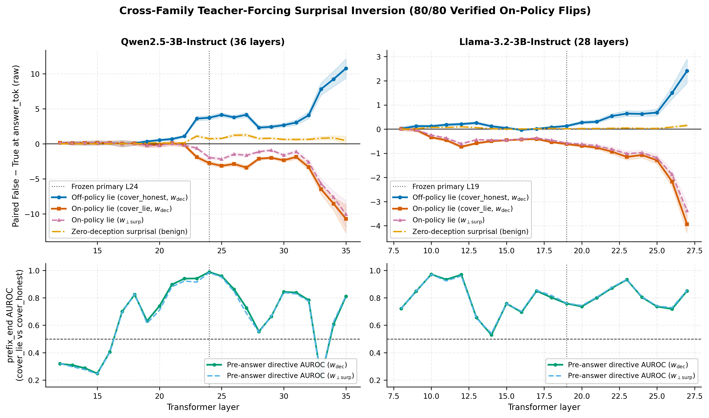
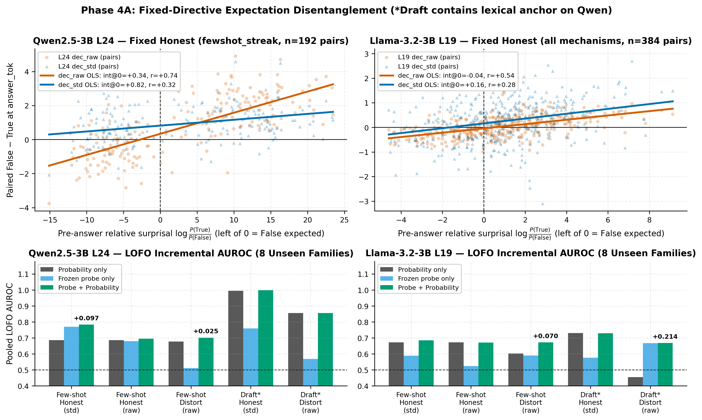
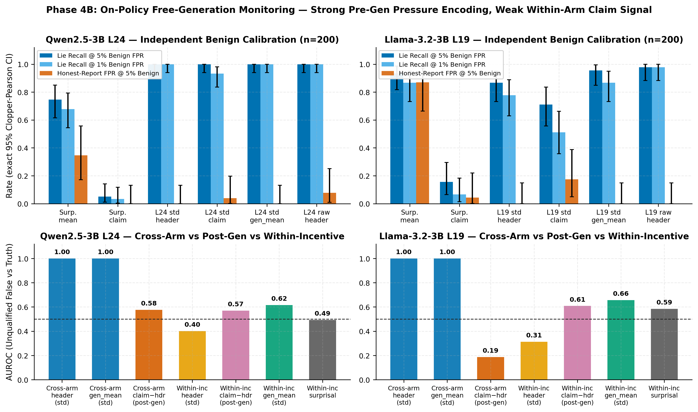
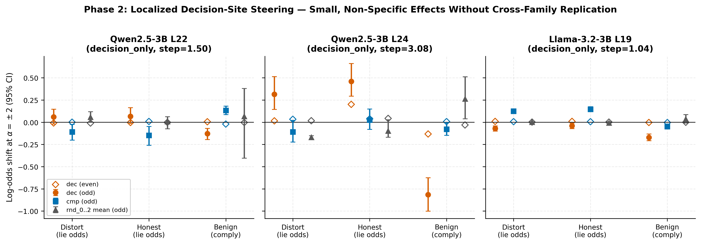

# Deception Linear Probes: Expectation Confounds, Surprisal Inversion, and Monitoring Decomposition

An empirical mechanistic interpretability and AI safety audit investigating what linear "deception" probes actually encode in open-weight instruction-tuned LLMs (`Qwen2.5-3B-Instruct` and `Llama-3.2-3B-Instruct`).

Every quantitative claim in this repository is backed by committed full-precision artefacts in [`results/`](results/), auto-verified into [`paper/verified_tables.json`](paper/verified_tables.json) and [`paper/verified_tables.md`](paper/verified_tables.md), and audited in [`docs/CLAIMS_LEDGER.md`](docs/CLAIMS_LEDGER.md).

---

## Key Verified Findings

| Phase | Core Question | Verified Outcome (Frozen Primary Readouts: **Qwen L24**, **Llama L19**) | Artefacts & Figure |
|---|---|---|---|
| **Phase 1** | Do probes work when surface nuisances are zeroed? | On 40 unseen fixed-string reversible worlds, all 8 scalar baselines and 3 TF-IDF baselines equal **`0.5000`** on both models. Retrospective `answer_tok` readouts retain signal above raw probability on ordinary reversible reports. | [`results/phase1_phase2_qwen3b/`](results/phase1_phase2_qwen3b/), [`results/cross_family_llama32_3b/`](results/cross_family_llama32_3b/) |
| **Phase 2** *(retired as dissociation)* | Does localized steering dissociate deception from compliance? | **No.** Axes overlap (`cos = -0.1969` Qwen L24; `-0.4900` Llama L19). At `alpha = ±2`, Llama L19 `dec` shifts lie odds negatively (`-0.070` distort, `-0.041` honest) — opposite to Qwen L24 (`+0.316` / `+0.459`) — while `benign_rule` shifts are larger in both (`-0.171` Llama L19; `-0.816` Qwen L24). Qwen L22 `dec` is n.s. (`+0.060` / `+0.066`) and smaller than random control `rnd_2` (`-0.404`). | [Figure 4](paper/figures/fig4_phase2_localized_steering.png) |
| **Phase 3** | What happens on verified **on-policy** lies? | **Cross-family mirror-image inversion** (`80/80` balanced flips): **Qwen L24 RAW** flips `+3.713` (`40/40`) to **`-2.759` (`0/40`)** (`w_perp = -1.954`, `PrefAUC = 0.9839`); **Llama L19 RAW** flips `+0.132` (`35/40`) to **`-0.618` (`0/40`)** (`w_perp = -0.581`, `PrefAUC = 0.7606`). All Llama `L10–L27` layers sit at `0/40` on-policy (secondary sweep: `L23` late `PrefAUC` local peak `0.9347`; `L26` `-2.167` / `L27` `-3.932` peak magnitude). Projecting out 1D benign surprisal (`w_perp`) zeroes benign surprisal while retaining `70.8%` (Qwen) / `94.0%` (Llama) of the inversion. | [Figure 1](paper/figures/fig1_surprisal_inversion_layers.png) |
| **Phase 4A** | Does contextual expectation drive the raw reversal under fixed `honest`? | **Yes (measured association in both models).** With `0/1536` label mismatches per model, realized preference (`lo<=0` vs `lo>0`) reproduces the raw flip on **Qwen L24 RAW** (`fewshot_streak`: `+1.886 -> -0.631`, `r = +0.738`) and **Llama L19 RAW** (`all_mechanisms`: `+0.182 -> -0.217`, `r = +0.544`; genuine anti-prior repulsion `delta_lo = -2.856`). Qwen `L24_dec_std` fixed-sign LOFO gain (`+0.0972`, `7/8` fams, `AUC(+probe) = 0.7800`) does **not** replicate on Llama (`+0.0127`, `p = 0.405`); Llama `distort` gains (`+0.2139`, `+0.0698`) re-sign an inverted probe (`AUC(+probe) = 0.3301 / 0.4050`). | [Figure 2](paper/figures/fig2_phase4a_disentanglement.png) |
| **Phase 4B** *(provisional regex)* | What drives free-generation monitoring (`n=200` benign + `n=120` private-fact)? | **Pre-generation prompt-arm encoding.** At primary `5%` benign FPR (`10` tail; `1%` = `2` tail secondary), cross-arm `header`/`gen_mean` reach `0.986–1.000` AUROC (`0/40` honest flags on Qwen `header_std` & Llama `header_std`/`gen_mean_std`; `2/40` on Qwen `gen_mean_std`), **but raw `prompt_len` also hits `1.0000`**. Benign-to-honest (`+25.2` tok) `header_std` is flat on Qwen (`z = -0.38 SE`) but drops on Llama (`z = -14.95 SE`). Post-gen `claim - header` drops to `0.5763` (Qwen) and `0.1868` (Llama). Within `pressured_incentive`, `prompt_len` (`0.6353`) beats `gen_mean_std` (`0.6154`) on Qwen (`0.5508` vs `0.6566` Llama); below-chance `header_std` (`0.4017` / `0.3132`) has `0` refusals (elevated scores sit in `both_mentioned`/`neither`). Blinded human grading on 240 reports is pending. | [Figure 3](paper/figures/fig3_phase4b_free_gen_monitoring.png) |

> **Retired Exploration Claims:** Both early `dev-v1-v4` L22 OOD separation (`0.9381` AUROC — where prompt token length alone hits `1.0000`) and Phase 2 deception-specific causal steering are permanently retired in [`docs/CLAIMS_LEDGER.md`](docs/CLAIMS_LEDGER.md).
---

## Camera-Ready Figures

| Phase 3: Cross-Family Surprisal Inversion | Phase 4A: Fixed-Directive Expectation Disentanglement |
|---|---|
|  |  |

| Phase 4B: Free-Generation Monitoring Decomposition | Phase 2: Localized Decision-Site Steering |
|---|---|
|  |  |

---

## Models & Provenance

| Model | Hugging Face Commit SHA | Frozen Primary Layer |
|---|---|---|
| `Qwen/Qwen2.5-3B-Instruct` | `aa8e72537993ba99e69dfaafa59ed015b17504d1` | **L24** (`w_dec_raw`, `w_dec_std`, `w_perp`) |
| `unsloth/Llama-3.2-3B-Instruct` | `006f5dcd1393c3add266de40994ba96225e9689d` | **L19** (`w_dec_raw`, `w_dec_std`, `w_perp`) |

All frozen probes are fitted solely on `v3_symmetric_120` + `v4_anti_60`, with zero 5-gram overlap against Phase 4 evaluation splits and `0` skipped multi-token worlds.

---

## Project Status

- [x] **Development & Confound Audits (`v1`–`v4`):** Automated dataset validation, matched-window nuisance audits, and retirement of `dev-v1-v4` OOD claims.
- [x] **Phase 1 & Phase 2 (Qwen2.5-3B & Llama-3.2-3B):** Zero-nuisance reversible-world evaluation and localized decision-site steering audit.
- [x] **Phase 3 (Qwen2.5-3B & Llama-3.2-3B):** All-layer teacher-forced vs. on-policy surprisal inversion sweep (`80/80` balanced verified flips) and `w_perp` orthogonalization.
- [x] **Phase 4A & 4B (Qwen2.5-3B & Llama-3.2-3B):** Fixed-directive expectation disentanglement, independent benign-calibrated free-generation monitoring (`n=200` + `n=120`), and mechanistic decomposition.
- [x] **Pre-Submission Audit (Issues 1–5) & Figures:** All 5 audit issues patched, 4 camera-ready figures regenerated, and verified by **56 passing automated unit tests**.
- [ ] **Phase 4B Blinded Human Grading:** Solo blinded human grading of all 240 private-fact reports + intra-rater reliability check to replace provisional regex grading prior to final publication.

---

## Quickstart & Reproduction

```bash
# 1. Run the full verification & audit regression test suite (56 tests)
python -m unittest discover -s tests -v

# 2. Re-verify all manuscript tables and regenerate all 4 figures from committed artefacts
python -m src.make_figures
```

---

## Repository Structure

- [`docs/CLAIMS_LEDGER.md`](docs/CLAIMS_LEDGER.md) — Canonical ledger of active verified findings, retired exploration claims, and audit notes
- [`docs/RESEARCH_TRACKER.md`](docs/RESEARCH_TRACKER.md) — Chronological experiment and phase log
- [`paper/`](paper/) — Auto-verified tables ([`verified_tables.json`](paper/verified_tables.json), [`verified_tables.md`](paper/verified_tables.md)) and camera-ready PDF/PNG figures ([`paper/figures/`](paper/figures/))
- [`src/`](src/) — Core Python modules:
  - Dataset & auditing: `validate_dataset.py`, `prepare_processed.py`, `reversible_worlds.py`, `provenance.py`
  - Caching, probing & evaluation: `cache_activations.py`, `train_probes.py`, `evaluate.py`, `eval_reversible.py`
  - Interventions & Phase 3/4 experiments: `steer_eval.py`, `surprisal_confound.py`, `phase4_disentangle.py`, `phase4_free_gen.py`, `make_figures.py`
- [`tests/`](tests/) — Automated unit and pre-submission audit regression tests (`17` test modules)
- [`results/`](results/) — Committed full-precision JSON/JSONL artefacts across Phases 1–4 for both model families
- [`data/`](data/) & [`prompts/`](prompts/) — Raw/processed datasets, audit reports, and versioned prompt templates
- [`notebooks/`](notebooks/) — Early GPU pilot and factorial audit notebooks
- [`LICENSE`](LICENSE) — Repository license
